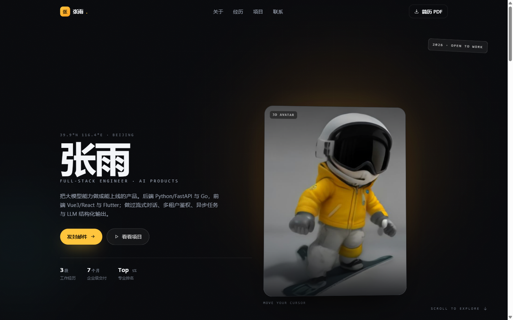

# resume

个人简历站。浅色、等宽字体、克制动效，单页静态站点。

- **在线地址**：<https://henanpengyuyan4444-beep.github.io/resume/>
- **仓库**：<https://github.com/henanpengyuyan4444-beep/resume>



## 特点

- **Astro 5 + Tailwind CSS 4**，构建产物只有 3 个文件（HTML + CSS + 图标），没有运行时框架
- 内容与样式分离：所有文案集中在 `src/config.ts`，改内容不用碰组件
- 中文排版：拉丁字母用 IBM Plex Mono，中文回落到系统字体（苹方 / 雅黑 / 思源）
- 轻交互：首屏淡入、区块滚动入场、导航随滚动高亮、悬停反馈
- 打印友好：隐藏固定顶栏、压缩留白，可另存为 A4 PDF（仓库里有 `张雨-简历-Astro.pdf` 示例）
- 响应式：桌面双栏、移动端单列

## 快速开始

```bash
npm install
npm run dev      # http://localhost:4321/resume/
npm run build    # 产物在 dist/
npm run preview  # 本地预览构建结果
```

## 改内容

只改 `src/config.ts`：

```ts
export const siteConfig = {
  name: "你的名字",
  title: "职位 / 方向",
  accentColor: "#4F46E5",        // 主色，全站跟着变
  location: "北京",
  phone: "13800000000",
  status: "2026 届 · 随时到岗",
  social: { email: "you@example.com" },  // github / linkedin / twitter 可选
  aboutMe: "自我介绍……",
  skills: ["Python", "FastAPI"],
  projects: [{ name, description, link, skills }],
  experience: [{ company, title, dateRange, bullets }],
  education: [{ school, degree, dateRange, achievements }],
};
```

删掉某个数组（比如 `projects`）对应区块会自动隐藏。

## 部署

GitHub Pages + Actions 已经配好，推 `main` 就自动构建发布：

- 工作流：`.github/workflows/deploy.yml`
- 仓库设置：Settings → Pages → Source = **GitHub Actions**

因为项目站点发布在 `/<仓库名>/` 子路径下，`astro.config.mjs` 里设置了：

```js
site: "https://henanpengyuyan4444-beep.github.io",
base: "/resume",
```

**换了仓库名或用户名时要同步改这两行**，否则 CSS / 图标会 404。

也可以把 `dist/` 拖到 Vercel / Netlify，或任何静态托管。

## 技术栈

- [Astro](https://astro.build/) 5
- [Tailwind CSS](https://tailwindcss.com/) 4
- [Tabler Icons](https://tabler.io/icons)（图标路径内联）

## 来源与许可

页面骨架来自开源项目 [RyanFitzgerald/devportfolio](https://github.com/RyanFitzgerald/devportfolio)（MIT），
在其基础上做了内容填充、中文本地化、电话字段、滚动入场 / 导航高亮、打印样式、中文回退字体与 Pages 子路径适配。

原项目的 MIT 许可证见 [LICENSE.md](./LICENSE.md)。

## 说明

- 页面包含真实联系方式（手机号 + 邮箱），仓库与站点均为公开；不想公开就把 `phone` 留空、邮箱换成表单。
- 导出的 PDF 是「网页打印」版（5 页），用于存档；投递用的精简一页版建议单独排版。
